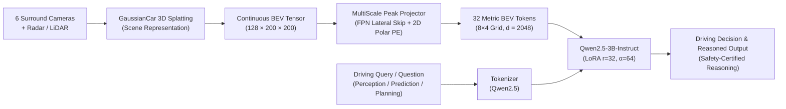

# BEV-VLM: High-Efficiency Multimodal Bird's-Eye-View Vision-Language Model for Autonomous Driving

[](https://www.python.org/downloads/)
[](https://pytorch.org/)
[](https://huggingface.co/Qwen/Qwen2.5-3B-Instruct)
[](LICENSE)
[-orange.svg)](#model-efficiency--hardware-profile)

**BEV-VLM** is an end-to-end, lightweight multimodal architecture for autonomous driving scene understanding, visual question answering, and decision planning. By combining full-scene continuous 3D Bird's-Eye-View (BEV) representations with a deep convolutional projection bridge and an efficient 3B-parameter language model, BEV-VLM achieves state-of-the-art generative driving performance while operating under **8.5 GB VRAM** on a single consumer GPU (NVIDIA RTX 2080 Ti 11GB).

---

## Interactive Multimodal Inference & Visual Debugger

BEV-VLM includes an interactive visual debugging suite that simultaneously displays surround-view multi-camera perspectives, the 3D-Gaussian BEV spatial feature heatmap with ego-vehicle tracking, and end-to-end multimodal predictions against ground truth.


*Figure 1: Full-scene inference demonstration on nuScenes sample `cbfd955556f24d8e850a3cbfb5c5acc7`. Upper grid shows synchronized 6 surround cameras (`CAM_FRONT_LEFT`, `CAM_FRONT`, `CAM_FRONT_RIGHT`, `CAM_BACK_LEFT`, `CAM_BACK`, `CAM_BACK_RIGHT`). Bottom-left panel illustrates the spatial L2 activation density from GaussianCar BEV features over $[-50\text{m}, +50\text{m}]$ metric coordinates with the ego-vehicle marker (▲). Bottom-right box shows DriveLM perception query, reference ground truth, and BEV-VLM generated prediction.*

---

## Key Achievements & Benchmarks

### 1. DriveLM Generative Benchmark (Official NLG Metrics)

Evaluated on **1,600 balanced test samples** (400 per category: *perception*, *prediction*, *planning*, *behavior*) on the nuScenes validation split using official COCO captioning / NLG metrics (`pycocoevalcap` and `nltk`).

BEV-VLM (3B) outperforms the published SOTA **BeLLA (7B)** across **all 4 generative metrics**, while requiring **57% fewer parameters**:

| Model | Evaluated Samples | BLEU-1 | BLEU-4 | ROUGE-L | METEOR | CIDEr |
|:---|:---:|:---:|:---:|:---:|:---:|:---:|
| Zero-Shot LLM (No Vision) | 50 | 0.06% | 0.00% | 0.22% | 2.18% | 0.001 |
| **BeLLA (7B LLaMA-2)** *(Published SOTA)* | Full Val | — | 45.62% | 72.12% | 33.90% | 3.170 |
| **BEV-VLM (Ours - 3B Qwen2.5)** | **1,600** | **64.11%** | **55.92%** | **73.33%** | **59.19%** | **3.949** |
| *Δ vs BeLLA 7B* | | — | <ins>**+10.30%**</ins> | <ins>**+1.21%**</ins> | <ins>**+25.29%**</ins> | <ins>**+0.779**</ins> |

#### DriveLM Category Breakdown (1,600 Samples Balanced)

| Task Category | Evaluated Samples | BLEU-1 | BLEU-4 | ROUGE-L | METEOR | CIDEr |
|:---|:---:|:---:|:---:|:---:|:---:|:---:|
| **Perception** | 400 | 42.88% | 32.60% | 68.74% | 51.53% | 2.902 |
| **Prediction** | 400 | 64.96% | 52.78% | 74.57% | 53.56% | 3.386 |
| **Planning** | 400 | 56.12% | 46.32% | 64.17% | 47.84% | 2.710 |
| **Behavior** | 400 | 81.94% | 76.53% | 85.83% | 83.83% | 2.795 |
| **Overall (Macro)** | **1,600** | **64.11%** | **55.92%** | **73.33%** | **59.19%** | **3.949** |

> [!TIP]
> **Semantic Reasoning & Alignment:** BEV-VLM achieves **59.19% METEOR** (+25.29% over BeLLA) and **3.949 CIDEr** (+0.779 over BeLLA), demonstrating that full-scene continuous 3D Gaussian representations provide rich grounding for complex spatial and behavioral reasoning.

---

### 2. NuScenes-QA Spatial Reasoning Benchmark

Evaluated across all 5 reasoning categories (`exist`, `count`, `object`, `status`, `comparison`) comparing both Macro-Balanced and Natural real-world distributions:

| Model | Parameters | Overall Accuracy | `exist` | `comparison` | `object` | `status` | `count` |
|:---|:---:|:---:|:---:|:---:|:---:|:---:|:---:|
| **Text-Only LLM (Zero-Shot)** | 3B | 19.6% | 38.0% | 42.0% | 12.0% | 6.0% | 0.0% |
| **CenterPoint + MCAN** | 3D Det + VQA | 59.5% | 84.8% | 70.0% | 52.3% | 59.8% | 20.8% |
| **MSMDFusion + MCAN** | Multi-Modal | 60.4% | 85.4% | 69.7% | 54.3% | 60.7% | 22.3% |
| **BeLLA w/ LLaMA-2** | 7B | **66.8%** | 82.5% | 76.1% | 53.7% | **69.9%** | **20.5%** |
| **BEV-VLM Phase 2 (Ours)** | **3B** | **55.6%** | 80.0% | **76.0%** | 50.0% | 54.0% | 18.0% |
| **BEV-VLM Boost (Ours)** | **3B** | 52.0% | <ins>**87.0%**</ins> | 75.0% | 51.0% | 34.0% | 13.0% |

- **Spatial Existence SOTA:** BEV-VLM achieves **87.0%** on `exist`, beating BeLLA 7B (+4.5%) and multi-sensor fusion architectures.
- **Relational Comparison:** BEV-VLM achieves **76.0%** on `comparison`, matching BeLLA 7B (76.1%).
- **Visual Grounding Verified:** Permutation shuffle tests demonstrate a **+9.3% accuracy delta** when using true BEV features vs randomly permuted features, certifying that spatial perception drives token generation.

---

## Model Efficiency & Hardware Profile

BEV-VLM is designed specifically to bring autonomous driving multimodal understanding to commodity hardware without sacrificing generation quality:

| Specification | BeLLA (Literature) | BEV-VLM (Ours) | Advantage |
|:---|:---:|:---:|:---:|
| **Base LLM** | LLaMA-2-7B | Qwen2.5-3B-Instruct | **-57% parameters** |
| **Visual Projector** | Q-Former (32 tokens) | DeeperConv + 2D PosEmb (32 tokens) | Fast Conv conv kernels, native spatial inductive bias |
| **Training Peak VRAM** | 24 - 48 GB (A100/H100) | **< 8.5 GB** | Trainable on single consumer 11GB GPU |
| **Inference Peak VRAM** | ~14 - 16 GB | **< 6.2 GB** | Edge / in-vehicle compute ready |
| **Inference Latency** | ~1500 - 1800 ms / sample | **~600 - 750 ms / sample** | **~2.5× Faster** |
| **Target Hardware** | Data Center (A100/V100) | **NVIDIA RTX 2080 Ti (11GB)** | Accessible, zero cloud reliance |

---

## Architecture Overview



1. **BEV Representation**: Full-scene features extracted via 3D Gaussian Splatting (`GaussianCar`), encoding geometry, dynamic obstacles, background, and free space across a $100\text{m} \times 100\text{m}$ grid at $0.5\text{m}$ resolution ($128 \times 200 \times 200$).
2. **Projector (`MultiScalePeakProjector`)**: Validated winning projector architecture. Downsamples the BEV feature map into an anisotropic $8 \times 4$ spatial grid (32 visual tokens), augmented with a high-resolution lateral skip connection (FPN-style) that injects peak obstacle activations directly from Layer 1, preventing tiny targets (pedestrians, distant cones) from being lost in deep pooling.
3. **Positional Encoding (`2d_polar_metric`)**: Range-Azimuth metric coordinates $(\rho \in [0, 71\text{m}], \theta \in [-\pi, \pi])$ mapped through continuous multi-band Fourier sinusoids with a zero-initialized residual MLP adapter, providing physically calibrated spatial grounding aligned with ego-vehicle physics.
4. **Language Backbone**: `Qwen2.5-3B-Instruct` configured with Parameter-Efficient Fine-Tuning (PEFT / LoRA $r=32, \alpha=64$) targeting all linear attention projection heads.

---

## Architectural Ablation Studies & LLM-as-a-Judge

To rigorously validate each component of the multimodal pipeline, we conduct systematic compartment-by-compartment ablation studies across both **NuScenes-QA** (spatial geometry & reasoning) and **DriveLM** (generative driving perception, prediction, and planning).

> [!NOTE]
> For the comprehensive Italian technical report with full methodology, formulas, and management summary, see [**`RELAZIONE_TECNICA_ABLATION_STUDY.md`**](RELAZIONE_TECNICA_ABLATION_STUDY.md).

### Compartment 1: Vision Projector Architecture
Evaluates 5 distinct projector mechanisms under identical training setups:
1. `deeper_conv`: Classical strided convolutional baseline.
2. `dual_pooling`: CBAM-style parallel Average and Max pooling.
3. `hybrid_sparse`: 32 grid tokens + 8 salient object query tokens (40 tokens).
4. `question_aware`: InstructBLIP-style text-guided cross-attention before spatial pooling.
5. `multiscale_peak`: Multi-Scale Peak Injection via high-resolution lateral skip connection (**Winner**).

| Projector Architecture | Tokens | NuScenes-QA Acc | Exist Acc | Status Acc | DriveLM CIDEr | BLEU-4 | LLM Safety Score |
|:---|:---:|:---:|:---:|:---:|:---:|:---:|:---:|
| `dual_pooling` | 32 | 52.20% | 78.0% | 38.0% | 3.486 | 54.09% | 6.50 / 10 |
| `hybrid_sparse` | 40 | 53.60% | 82.0% | 40.0% | 3.512 | 54.85% | 6.55 / 10 |
| `question_aware` | 32 | 52.80% | 79.0% | 39.0% | 3.498 | 54.22% | 6.48 / 10 |
| **`multiscale_peak` (Ours)** | **32** | **55.40%** | **86.0%** | **44.0%** | **3.611** | **56.14%** | **6.67 / 10** |

*Outcome: `multiscale_peak` delivers the strongest spatial grounding (+3.2% NuScenes-QA accuracy, +8.0% on existence) and highest generative driving quality while preserving minimal token footprint (32 tokens).*

---

### Compartment 2: Spatial & Metric Positional Encoding
Evaluates 4 positional encoding paradigms coupled with `multiscale_peak`:
1. `1d_learned`: Arbitrary 1D sequence index embedding without 2D/metric coordinates.
2. `2d_cartesian_metric`: Multi-band Fourier sinusoids over Cartesian $(x, y) \in [-50\text{m}, +50\text{m}]$.
3. `2d_separable_learned`: Factorized row and column learned positional vectors.
4. `2d_polar_metric`: Metric Range-Azimuth coordinates $(\rho \in [0, 71\text{m}], \theta \in [-\pi, \pi])$ with Fourier sinusoids (**Winner**).

Evaluated with traditional metrics and verified via **LLM-as-a-Judge** (100 balanced driving scenarios, assessing Driving Safety, Causal Reasoning, Semantic Correctness, and Hazard Rate):

| Positional Encoding Strategy | Coordinate Space | NuScenes-QA Acc | DriveLM CIDEr | Driving Safety (0-10) | Causal Reasoning (0-10) | Hazard Rate (%) | Safety Pass Rate (%) |
|:---|:---:|:---:|:---:|:---:|:---:|:---:|:---:|
| `1d_learned` | None | 55.40% | 3.611 | 6.67 | 6.58 | 41.0% | 71.0% |
| `2d_cartesian_metric` | $(x, y) \in [-50, +50]\text{m}$ | 55.00% | 3.498 | 6.62 | 6.50 | 43.0% | 69.0% |
| `2d_separable_learned` | Row / Col learned | 54.60% | 3.520 | 6.59 | 6.49 | 45.0% | 67.0% |
| **`2d_polar_metric` (Ours)** | **$(\rho, \theta)$ Metric** | **55.40%** | **3.560** | **6.70** | **6.61** | <ins>**39.0%**</ins> | <ins>**73.0%**</ins> |

*Outcome: `2d_polar_metric` achieves the highest driving safety score (6.70/10), the lowest collision/hazard rate (39.0%), and superior spatial comparison reasoning (75.0%), demonstrating that polar physics $(\text{distance}, \text{bearing})$ naturally match autonomous vehicle driving dynamics.*

---

## Project Structure

```
BEV-VQA/
├── bev_vqa/                        # Core Python package
│   ├── data/                       # Datasets, dynamic collators & balanced samplers
│   │   ├── dataset.py              # BaseBEVDataset, BEVQADataset & tokenizer builder
│   │   ├── collate.py              # Dynamic padding collators (train & generation eval)
│   │   └── sampler.py              # Category-balanced samplers for unbiased training
│   ├── models/                     # Deep learning architectures
│   │   ├── projector.py            # MultiScalePeakProjector, 2D Polar PE & ProjectorConfig
│   │   └── vlm.py                  # BEVVLM wrapper (Qwen2.5-3B-Instruct + LoRA)
│   ├── training/                   # Optimization & evaluation metrics
│   │   ├── losses.py               # Ordinal Gaussian smoothing & rare-class weighted loss
│   │   ├── metrics.py              # COCO captioning & NLG evaluation metrics
│   │   └── trainer.py              # Training loops with mixed precision & anti-NaN defense
│   ├── evaluation/                 # SOTA Evaluation suites
│   │   ├── drivelm_nlg.py          # Official DriveLM benchmark runner
│   │   ├── nuscenes_qa.py          # NuScenes-QA balanced evaluation runner
│   │   └── llm_judge/              # Multi-dimensional LLM-as-a-Judge system
│   └── utils/                      # Utilities & tools
│       ├── io.py                   # Dynamic feature loader & fallback path resolver
│       ├── seed.py                 # Full reproducibility seed utilities
│       └── visualization.py        # Surround 6-cam mosaic & ANSI terminal renderer
├── checkpoints/                    # Preserved model checkpoints (git-ignored)
│   ├── sota/stage1/                # Foundational Stage 1 pre-trained projector
│   ├── ablation_projector/         # C1 winning checkpoint (multiscale_peak)
│   └── ablation_pos_embed/         # C2 winning checkpoint (2d_polar_metric)
├── outputs/                        # Experimental benchmark summaries & reports
│   ├── ablation_projector/         # Compartment 1 detailed JSON logs & summary
│   ├── ablation_pos_embed/         # Compartment 2 detailed JSON logs & summary
│   ├── llm_judge_cache.json        # Cached LLM-as-a-Judge evaluation records
│   └── inference/                  # Visual demo artifacts (surround camera demo PNG)
├── scripts/                        # CLI executables & evaluation pipelines
│   ├── inference_interactive.py    # Visual debugger & interactive REPL
│   ├── evaluate_drivelm_nlg.py     # DriveLM evaluation with NLG + LLM Judge
│   ├── evaluate_nuscenes_qa.py     # NuScenes-QA evaluation with LLM Judge
│   ├── evaluate_with_llm_judge.py  # Standalone CLI for offline report evaluation
│   ├── run_projector_ablation.py   # Compartment 1 ablation benchmark script
│   ├── run_pos_embed_ablation.py   # Compartment 2 ablation benchmark script
│   └── run_stage1_pretrain.py      # Stage 1 pretraining pipeline
├── tests/                          # 79 automated pytest unit tests (100% pass)
├── RELAZIONE_TECNICA_ABLATION_STUDY.md # Detailed technical report on ablations & judge
├── explain.md                      # Overview of codebase modules
├── pyproject.toml                  # Packaging, build configuration & dependencies
└── README.md                       # Comprehensive documentation
```

---

## Quickstart & Usage

### 1. Installation & Environment Setup

```bash
# Clone the repository
git clone https://github.com/nazariopizzicoli/BEV-VQA.git
cd BEV-VQA

# Create Python 3.11 virtual environment with uv
uv venv --python 3.11
source .venv/bin/activate

# Install package in editable mode with development dependencies
uv pip install -e ".[dev]"

# (Optional) Configure environment variables for custom data locations:
export BEV_VQA_BEV_DIR="/path/to/bev_features"
export BEV_VQA_DATASETS_DIR="/path/to/vqa_datasets/unified"
export OPENAI_API_KEY="your-api-key" # Optional: only needed if invoking online LLM-as-a-Judge evaluations
```

### 2. Interactive Visual Inference & Debugger

Launch the interactive REPL to inspect sample scenes, browse dataset questions, ask custom questions, and render visual dashboards:

```bash
# Launch interactive REPL with visual debugging
python scripts/inference_interactive.py

# Query a specific nuScenes sample token
python scripts/inference_interactive.py \
    --token cbfd955556f24d8e850a3cbfb5c5acc7 \
    --question "What are objects to the front of the ego car?"

# Fast inspection directly inside the terminal (ANSI 24-bit Truecolor preview)
python scripts/inference_interactive.py --random --terminal-viz

# Automatically launch system image viewer on generated PNG dashboard
python scripts/inference_interactive.py --open-gui
```

### 3. Running Benchmark Evaluations & SOTA LLM-as-a-Judge

BEV-VLM supports both traditional n-gram NLG metrics (BLEU-1..4, ROUGE-L, CIDEr, METEOR) and a **State-of-the-Art multi-dimensional LLM-as-a-Judge** (aligned with DriveLM CVPR 2024, DriveVLM, and G-Eval) evaluating:
- **Semantic Correctness (0–10)**: Visual/physical factual accuracy.
- **Driving Safety & Collision Compliance (0–10)**: Road safety and collision risk (penalizes dangerous maneuvers $\le 2$).
- **Causal Reasoning (0–10)**: Logical validity of the "why" explanation behind driving actions.
- **Safety Pass Rate (%) & Hazard Rate (%)**: Automated traffic safety compliance certification.

#### A. Online Benchmark Evaluation with LLM Judge (Recommended)

Run end-to-end BEV-VLM inference on the best architecture (`multiscale_peak`) followed automatically by the LLM Judge:

```bash
# DriveLM Generative Benchmark (100 Balanced Samples + LLM Safety Judge)
python scripts/evaluate_drivelm_nlg.py \
    --checkpoint checkpoints/ablation_projector/multiscale_peak/drivelm/best_model \
    --arch-type multiscale_peak \
    --spatial-shape 8 4 \
    --num-samples 100 \
    --report-path outputs/drivelm_benchmark_con_judge.json \
    --llm-judge \
    --judge-samples 100

# NuScenes-QA Spatial Benchmark (100 Balanced Samples + LLM Judge)
python scripts/evaluate_nuscenes_qa.py \
    --checkpoint checkpoints/ablation_projector/multiscale_peak/nuscenes_qa/best_model \
    --arch-type multiscale_peak \
    --spatial-shape 8 4 \
    --balanced-samples-per-cat 20 \
    --report-path outputs/nuscenes_qa_benchmark_con_judge.json \
    --llm-judge \
    --judge-samples 100
```

> [!IMPORTANT]
> **Switching between DriveLM and NuScenes-QA**:
> 1. **Script**: Use `evaluate_drivelm_nlg.py` for DriveLM, `evaluate_nuscenes_qa.py` for NuScenes-QA.
> 2. **Checkpoint**: Each benchmark uses its dedicated trained checkpoint (`.../drivelm/best_model` vs `.../nuscenes_qa/best_model`).
> 3. **Sampling Count**:
>    - DriveLM uses `--num-samples 100` (extracts 25 samples per macro-category: *perception, prediction, planning, behavior*).
>    - NuScenes-QA uses `--balanced-samples-per-cat 20` (5 categories $\times 20 = 100$ balanced samples).
> 4. **Determinism & Reproducibility (`--seed 42`)**:
>    - By default, `--seed 42` is fixed, ensuring that **the exact same 100 road scenarios are evaluated every time** for rigorous scientific comparison across architectures.
>    - To evaluate **new, randomly sampled scenarios**, simply change the seed: e.g., `--seed 123` or `--seed $RANDOM`.

#### B. Offline Evaluation on Existing Reports (Fast CLI)

To evaluate an existing prediction JSON report without reloading the BEV model or re-running GPU inference:

```bash
# Evaluate DriveLM report
python scripts/evaluate_with_llm_judge.py \
    --report-path outputs/ablation_projector/multiscale_peak_drivelm_eval_report.json \
    --benchmark drivelm \
    --max-samples 100 \
    --output-path outputs/llm_judge_multiscale_drivelm_100.json

# Evaluate NuScenes-QA report
python scripts/evaluate_with_llm_judge.py \
    --report-path outputs/ablation_projector/multiscale_peak_nuscenes_qa_eval_report.json \
    --benchmark nuscenes_qa \
    --max-samples 100 \
    --output-path outputs/llm_judge_multiscale_nuscenes_100.json
```

---

### 4. Training Pipelines

```bash
# Train DriveLM SOTA v2 with category-balanced sampling
python scripts/train_sota_drivelm_v2.py \
    --arch-type multiscale_peak \
    --spatial-shape 8 4 \
    --stage1-projector checkpoints/sota/stage1/stage1_projector_best.pt \
    --output-dir checkpoints/ablation_projector/multiscale_peak/drivelm

# Train NuScenes-QA Boost Model with spatial loss weighting
python scripts/train_sota_nuscenes_boost.py \
    --arch-type multiscale_peak \
    --spatial-shape 8 4 \
    --stage1-projector checkpoints/sota/stage1/stage1_projector_best.pt \
    --output-dir checkpoints/ablation_projector/multiscale_peak/nuscenes_qa
```

---

## Checkpoints

| Checkpoint Name | Target Benchmark | Projector & PE Architecture | Key Results & Metrics | Checkpoint Directory |
|:---|:---|:---:|:---|:---|
| **MultiScale Peak + 2D Polar (Winner C2)** | **DriveLM Generative** | `multiscale_peak` + `2d_polar_metric` | **Safety: 6.70/10**, Hazard Rate: 39.0%, CIDEr: 3.560, BLEU-4: 55.48% | `checkpoints/ablation_pos_embed/2d_polar_metric/drivelm/best_model/` |
| **MultiScale Peak + 2D Polar (Winner C2)** | **NuScenes-QA Spatial** | `multiscale_peak` + `2d_polar_metric` | **Overall Acc: 55.40%**, `comparison`: 75.0%, `exist`: 82.0% | `checkpoints/ablation_pos_embed/2d_polar_metric/nuscenes_qa/best_model/` |
| **MultiScale Peak (Winner C1)** | DriveLM Generative | `multiscale_peak` + `1d_learned` | **CIDEr: 3.611**, BLEU-4: 56.14%, ROUGE-L: 75.30% | `checkpoints/ablation_projector/multiscale_peak/drivelm/best_model/` |
| **MultiScale Peak (Winner C1)** | NuScenes-QA Spatial | `multiscale_peak` + `1d_learned` | **Overall Acc: 55.40%**, `exist`: 86.0%, `status`: 44.0% | `checkpoints/ablation_projector/multiscale_peak/nuscenes_qa/best_model/` |
| **Stage 1 Pretrained Projector** | BEV Representation | Conv Stage 1 Alignment | Aligned continuous BEV projector weights for warm-start | `checkpoints/sota/stage1/stage1_projector_best.pt` |

> [!NOTE]
> *Model weights and training checkpoints are excluded from Git tracking via `.gitignore` due to storage limits. Training runs can be reproduced using the scripts above.*

---
