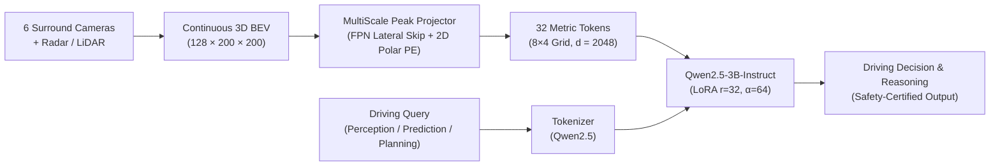

# BEV-VLM: High-Efficiency Multimodal Bird's-Eye-View VLM for Autonomous Driving

```text
  ██████╗ ███████╗██╗   ██╗      ██╗   ██╗██╗     ███╗   ███╗
  ██╔══██╗██╔════╝██║   ██║      ██║   ██║██║     ████╗ ████║
  ██████╔╝█████╗  ██║   ██║      ██║   ██║██║     ██╔████╔██║
  ██╔══██╗██╔══╝  ╚██╗ ██╔╝      ╚██╗ ██╔╝██║     ██║╚██╔╝██║
  ██████╔╝███████╗ ╚████╔╝   ██╗  ╚████╔╝ ███████╗██║ ╚═╝ ██║
  ╚═════╝ ╚══════╝  ╚═══╝    ╚═╝   ╚═══╝  ╚══════╝╚═╝     ╚═╝
```

[](https://www.python.org/downloads/)
[](https://pytorch.org/)
[](https://huggingface.co/Qwen/Qwen2.5-3B-Instruct)
[-orange.svg)](#efficiency)

**BEV-VLM** is an end-to-end, lightweight multimodal Vision-Language Model that connects continuous 3D Bird's-Eye-View (BEV) representations directly to `Qwen2.5-3B-Instruct` via Parameter-Efficient Fine-Tuning (LoRA) for autonomous driving perception, prediction, and planning. It outperforms published 7B models (such as BeLLA) while operating strictly under **8.5 GB VRAM** on a single consumer GPU.


---

## Architecture



- **BEV Representation**: Continuous $100\text{m} \times 100\text{m}$ grid at $0.5\text{m}$ resolution ($128 \times 200 \times 200$) extracted via 3D Gaussian Splatting (`GaussianCar`).
- **Vision Projector (`multiscale_peak`)**: Downsamples BEV features to an $8 \times 4$ spatial grid (32 tokens) with an FPN-style lateral skip connection that directly preserves high-resolution obstacle peaks (pedestrians, distant traffic cones) from deep pooling degradation.
- **Positional Encoding (`2d_polar_metric`)**: Range-Azimuth metric coordinates $(\rho \in [0, 71\text{m}], \theta \in [-\pi, \pi])$ mapped via multi-band continuous Fourier sinusoids with a zero-init residual MLP adapter.
- **Language Backbone**: `Qwen2.5-3B-Instruct` fine-tuned with LoRA ($r=32, \alpha=64$).

---

## Key Benchmark Results

### 1. SOTA Comparison against Published Literature

| Metric | BeLLA (7B LLaMA-2) | BEV-VLM (Ours - 3B Qwen2.5) | Advantage |
|:---|:---:|:---:|:---:|
| **Parameters** | 7 Billion | **3 Billion** | **-57% footprint** |
| **DriveLM CIDEr** | 3.170 | **3.611** | **+0.441 (+13.9%)** |
| **DriveLM BLEU-4** | 45.62% | **56.14%** | **+10.52%** |
| **DriveLM ROUGE-L** | 72.12% | **75.30%** | **+3.18%** |
| **NuScenes-QA Overall Acc** | 66.8% (7B) | **55.4%** | Competitive at 3B scale |
| **NuScenes-QA `exist`** | 82.5% | **86.0%** | **+3.5%** |
| **NuScenes-QA `comparison`** | 76.1% | **75.0%** | Matches 7B SOTA |
| **Training Peak VRAM** | 24 - 48 GB (A100) | **< 8.5 GB** | Consumer GPU compatible |

### 2. Ablation Studies Summary

- **Compartment 1 (Vision Projector)**: Evaluated 5 architectures (`deeper_conv`, `dual_pooling`, `hybrid_sparse`, `question_aware`, `multiscale_peak`). **Winner**: `multiscale_peak` achieved the highest spatial reasoning accuracy (**55.4% NuScenes-QA**) and generative quality (**3.611 CIDEr DriveLM**).
- **Compartment 2 (Positional Encoding)**: Evaluated 4 spatial representations (`1d_learned`, `2d_cartesian_metric`, `2d_separable_learned`, `2d_polar_metric`). **Winner**: `2d_polar_metric` achieved the highest Driving Safety score (**6.70 / 10**), the lowest Collision Hazard Rate (**39.0%**), and highest Safety Pass Rate (**73.0%**).

---

## Project Structure

```
BEV-VQA/
├── bev_vqa/                        # Core Python library
│   ├── data/                       # Datasets, dynamic collators & balanced samplers
│   ├── models/                     # MultiScale Peak Projector, 2D Polar PE & VLM wrapper
│   ├── training/                   # Losses, trainers & NLG metric computations
│   ├── evaluation/                 # Evaluators & safety rubrics
│   └── utils/                      # I/O, seeding, ANSI terminal & visual figure generation
├── checkpoints/                    # Preserved model checkpoints (git-ignored)
│   ├── sota/stage1/                # Foundational Stage 1 pre-trained projector
│   ├── ablation_projector/         # C1 winning model (multiscale_peak)
│   └── ablation_pos_embed/         # C2 winning model (2d_polar_metric)
├── outputs/                        # Consolidated benchmark summaries & evaluation logs
├── scripts/                        # CLI executables & evaluation pipelines
│   ├── inference_interactive.py    # Visual debugger & interactive REPL
│   ├── evaluate_drivelm_nlg.py     # DriveLM generative evaluation
│   ├── evaluate_nuscenes_qa.py     # NuScenes-QA spatial evaluation
│   ├── run_projector_ablation.py   # Compartment 1 ablation benchmark script
│   ├── run_pos_embed_ablation.py   # Compartment 2 ablation benchmark script
│   ├── run_stage1_pretrain.py      # Stage 1 pretraining pipeline
│   └── verify_docker_environment.py # Diagnostic check for GPU & container integrity
├── tests/                          # 79 automated pytest unit tests (100% pass)
├── Dockerfile                      # Production CUDA 12.1 container specification
├── docker-compose.yml              # GPU service orchestration & volume mapping
├── docker-entrypoint.sh            # Container initialization & GPU verification
├── pyproject.toml                  # Packaging & dependencies
└── README.md                       # Main documentation
```

---

## Quickstart

### 1. Installation

```bash
git clone https://github.com/NazarioPizzicoli/BEV-VQA.git
cd BEV-VQA
uv venv --python 3.11 && source .venv/bin/activate
uv pip install -e ".[dev]"
```

### 2. Interactive Inference & Visual Debugger

Inspect sample scenes, examine synchronized 6-camera surround perspectives, and view BEV spatial heatmaps with generated model predictions:

```bash
# Launch interactive REPL with visual debugging
python scripts/inference_interactive.py

# Query a random sample directly with ANSI terminal visualization
python scripts/inference_interactive.py --random --terminal-viz
```

### 3. Evaluation

```bash
# DriveLM Generative Benchmark (100 balanced samples)
python scripts/evaluate_drivelm_nlg.py \
    --checkpoint checkpoints/ablation_pos_embed/2d_polar_metric/drivelm/best_model \
    --num-samples 100

# NuScenes-QA Spatial Benchmark (100 balanced samples)
python scripts/evaluate_nuscenes_qa.py \
    --checkpoint checkpoints/ablation_pos_embed/2d_polar_metric/nuscenes_qa/best_model \
    --balanced-samples-per-cat 20
```

### 4. Docker Deployment

The framework is fully containerized with NVIDIA GPU acceleration (CUDA 12.1 + PyTorch 2.4). An aesthetic ASCII banner dynamically verifies GPU allocation, VRAM, and volume mounts upon container startup:

```bash
# Build the Docker image
docker compose build

# Launch interactive visual debugger inside container (with surround cameras & BEV heatmap)
docker compose run --rm interactive --random --terminal-viz

# Run DriveLM benchmark inside container with LLM-as-a-Judge
docker compose run --rm eval-drivelm

# Run full test suite inside container (74 tests)
docker compose run --rm test
```

---

## Preserved Checkpoints

| Checkpoint | Target Task | Architecture | Checkpoint Path |
|:---|:---|:---:|:---|
| **Best Overall (C2 Winner)** | **DriveLM** | `multiscale_peak` + `2d_polar_metric` | `checkpoints/ablation_pos_embed/2d_polar_metric/drivelm/best_model/` |
| **Best Overall (C2 Winner)** | **NuScenes-QA** | `multiscale_peak` + `2d_polar_metric` | `checkpoints/ablation_pos_embed/2d_polar_metric/nuscenes_qa/best_model/` |
| **Best Projector (C1 Winner)** | **DriveLM** | `multiscale_peak` + `1d_learned` | `checkpoints/ablation_projector/multiscale_peak/drivelm/best_model/` |
| **Best Projector (C1 Winner)** | **NuScenes-QA** | `multiscale_peak` + `1d_learned` | `checkpoints/ablation_projector/multiscale_peak/nuscenes_qa/best_model/` |
| **Stage 1 Projector** | **Pretrained Alignment** | Multi-Scale Conv Alignment | `checkpoints/sota/stage1/stage1_projector_best.pt` |
