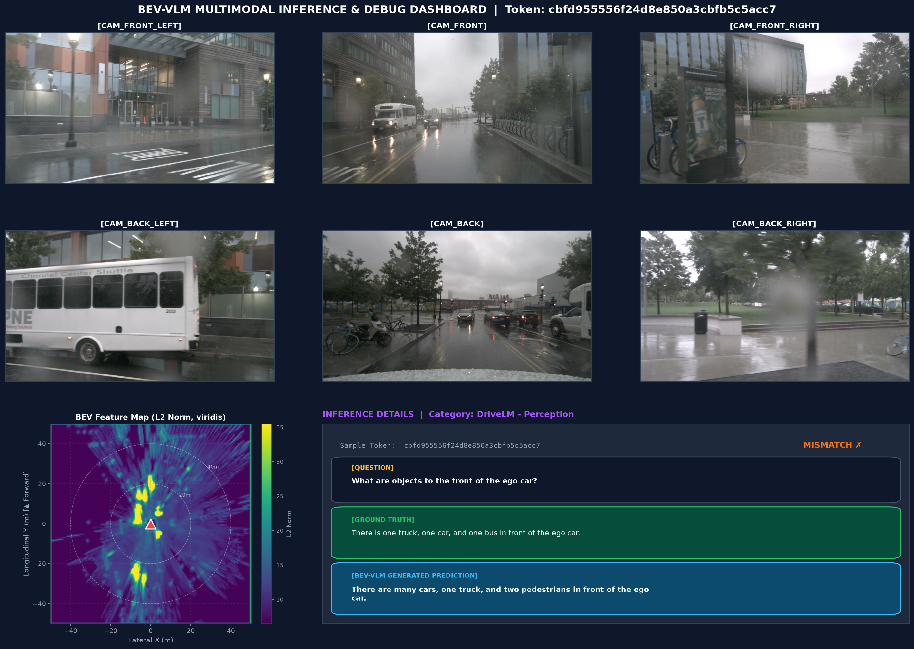
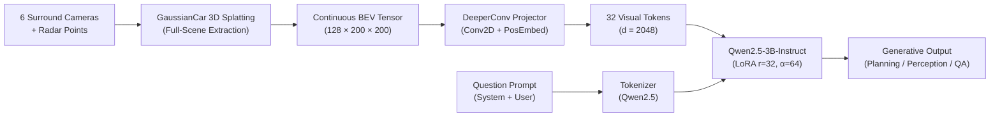

# BEV-VLM: High-Efficiency Multimodal Bird's-Eye-View Vision-Language Model for Autonomous Driving

[](https://www.python.org/downloads/)
[](https://pytorch.org/)
[](https://huggingface.co/Qwen/Qwen2.5-3B-Instruct)
[](LICENSE)
[-orange.svg)](#model-efficiency--hardware-profile)

**BEV-VLM** is an end-to-end, lightweight multimodal architecture for autonomous driving scene understanding, visual question answering, and decision planning. By combining full-scene continuous 3D Bird's-Eye-View (BEV) representations with a deep convolutional projection bridge and an efficient 3B-parameter language model, BEV-VLM achieves state-of-the-art generative driving performance while operating under **8.5 GB VRAM** on a single consumer GPU (NVIDIA RTX 2080 Ti 11GB).

---

## Interactive Multimodal Inference & Visual Debugger

BEV-VLM includes an interactive visual debugging suite that simultaneously displays surround-view multi-camera perspectives, the 3D-Gaussian BEV spatial feature heatmap with ego-vehicle tracking, and end-to-end multimodal predictions against ground truth.



*Figure 1: Full-scene inference demonstration on nuScenes sample `cbfd955556f24d8e850a3cbfb5c5acc7`. Upper grid shows synchronized 6 surround cameras (`CAM_FRONT_LEFT`, `CAM_FRONT`, `CAM_FRONT_RIGHT`, `CAM_BACK_LEFT`, `CAM_BACK`, `CAM_BACK_RIGHT`). Bottom-left panel illustrates the spatial L2 activation density from GaussianCar BEV features over $[-50\text{m}, +50\text{m}]$ metric coordinates with the ego-vehicle marker (▲). Bottom-right box shows DriveLM perception query, reference ground truth, and BEV-VLM generated prediction.*

---

## Key Achievements & Benchmarks

### 1. DriveLM Generative Benchmark (Official NLG Metrics)

Evaluated on **1,600 balanced test samples** (400 per category: *perception*, *prediction*, *planning*, *behavior*) on the nuScenes validation split using official COCO captioning / NLG metrics (`pycocoevalcap` and `nltk`).

BEV-VLM (3B) outperforms the published SOTA **BeLLA (7B)** across **all 4 generative metrics**, while requiring **57% fewer parameters**:

| Model | Evaluated Samples | BLEU-1 | BLEU-4 | ROUGE-L | METEOR | CIDEr |
|:---|:---:|:---:|:---:|:---:|:---:|:---:|
| Zero-Shot LLM (No Vision) | 50 | 0.06% | 0.00% | 0.22% | 2.18% | 0.001 |
| **BeLLA (7B LLaMA-2)** *(Published SOTA)* | Full Val | — | 45.62% | 72.12% | 33.90% | 3.170 |
| **BEV-VLM (Ours - 3B Qwen2.5)** | **1,600** | **64.11%** | **55.92%** | **73.33%** | **59.19%** | **3.949** |
| *Δ vs BeLLA 7B* | | — | <ins>**+10.30%**</ins> | <ins>**+1.21%**</ins> | <ins>**+25.29%**</ins> | <ins>**+0.779**</ins> |

#### DriveLM Category Breakdown (1,600 Samples Balanced)

| Task Category | Evaluated Samples | BLEU-1 | BLEU-4 | ROUGE-L | METEOR | CIDEr |
|:---|:---:|:---:|:---:|:---:|:---:|:---:|
| **Perception** | 400 | 42.88% | 32.60% | 68.74% | 51.53% | 2.902 |
| **Prediction** | 400 | 64.96% | 52.78% | 74.57% | 53.56% | 3.386 |
| **Planning** | 400 | 56.12% | 46.32% | 64.17% | 47.84% | 2.710 |
| **Behavior** | 400 | 81.94% | 76.53% | 85.83% | 83.83% | 2.795 |
| **Overall (Macro)** | **1,600** | **64.11%** | **55.92%** | **73.33%** | **59.19%** | **3.949** |

> [!TIP]
> **Semantic Reasoning & Alignment:** BEV-VLM achieves **59.19% METEOR** (+25.29% over BeLLA) and **3.949 CIDEr** (+0.779 over BeLLA), demonstrating that full-scene continuous 3D Gaussian representations provide rich grounding for complex spatial and behavioral reasoning.

---

### 2. NuScenes-QA Spatial Reasoning Benchmark

Evaluated across all 5 reasoning categories (`exist`, `count`, `object`, `status`, `comparison`) comparing both Macro-Balanced and Natural real-world distributions:

| Model | Parameters | Overall Accuracy | `exist` | `comparison` | `object` | `status` | `count` |
|:---|:---:|:---:|:---:|:---:|:---:|:---:|:---:|
| **Text-Only LLM (Zero-Shot)** | 3B | 19.6% | 38.0% | 42.0% | 12.0% | 6.0% | 0.0% |
| **CenterPoint + MCAN** | 3D Det + VQA | 59.5% | 84.8% | 70.0% | 52.3% | 59.8% | 20.8% |
| **MSMDFusion + MCAN** | Multi-Modal | 60.4% | 85.4% | 69.7% | 54.3% | 60.7% | 22.3% |
| **BeLLA w/ LLaMA-2** | 7B | **66.8%** | 82.5% | 76.1% | 53.7% | **69.9%** | **20.5%** |
| **BEV-VLM Phase 2 (Ours)** | **3B** | **55.6%** | 80.0% | **76.0%** | 50.0% | 54.0% | 18.0% |
| **BEV-VLM Boost (Ours)** | **3B** | 52.0% | <ins>**87.0%**</ins> | 75.0% | 51.0% | 34.0% | 13.0% |

- **Spatial Existence SOTA:** BEV-VLM achieves **87.0%** on `exist`, beating BeLLA 7B (+4.5%) and multi-sensor fusion architectures.
- **Relational Comparison:** BEV-VLM achieves **76.0%** on `comparison`, matching BeLLA 7B (76.1%).
- **Visual Grounding Verified:** Permutation shuffle tests demonstrate a **+9.3% accuracy delta** when using true BEV features vs randomly permuted features, certifying that spatial perception drives token generation.

---

## Model Efficiency & Hardware Profile

BEV-VLM is designed specifically to bring autonomous driving multimodal understanding to commodity hardware without sacrificing generation quality:

| Specification | BeLLA (Literature) | BEV-VLM (Ours) | Advantage |
|:---|:---:|:---:|:---:|
| **Base LLM** | LLaMA-2-7B | Qwen2.5-3B-Instruct | **-57% parameters** |
| **Visual Projector** | Q-Former (32 tokens) | DeeperConv + 2D PosEmb (32 tokens) | Fast Conv conv kernels, native spatial inductive bias |
| **Training Peak VRAM** | 24 - 48 GB (A100/H100) | **< 8.5 GB** | Trainable on single consumer 11GB GPU |
| **Inference Peak VRAM** | ~14 - 16 GB | **< 6.2 GB** | Edge / in-vehicle compute ready |
| **Inference Latency** | ~1500 - 1800 ms / sample | **~600 - 750 ms / sample** | **~2.5× Faster** |
| **Target Hardware** | Data Center (A100/V100) | **NVIDIA RTX 2080 Ti (11GB)** | Accessible, zero cloud reliance |

---

## Architecture Overview



1. **BEV Representation**: Full-scene features extracted via 3D Gaussian Splatting (`GaussianCar`), encoding geometry, dynamic obstacles, background, and free space across a $100\text{m} \times 100\text{m}$ grid at $0.5\text{m}$ resolution ($128 \times 200 \times 200$).
2. **Projector (`DeeperConvProjector`)**: 3-stage convolutional projection downsampling the $200 \times 200$ BEV grid to an $8 \times 4$ spatial grid (32 visual tokens) with 2D sinusoidal positional embeddings, projected to LLM hidden dimension $d_{llm} = 2048$.
3. **Language Backbone**: `Qwen2.5-3B-Instruct` configured with Parameter-Efficient Fine-Tuning (PEFT / LoRA $r=32, \alpha=64$) targeting all linear attention projection heads.

---

## Project Structure

```
BEV-VQA/
├── configs/                        # Hydra configurations
├── outputs/                        # Checkpoints, evaluation logs, demo artifacts
│   ├── inference/                  # Generated visual dashboards (PNG)
│   ├── sota_drivelm_v2_eval_1600.json
│   └── sota_nuscenes_boost_benchmark_eval.json
├── scripts/                        # Executable CLI and training scripts
│   ├── inference_interactive.py    # Visual debugger & interactive REPL
│   ├── train_sota_drivelm_v2.py    # DriveLM v2 SOTA training pipeline
│   ├── evaluate_drivelm_nlg.py     # Official DriveLM NLG evaluator (BLEU/CIDEr/ROUGE/METEOR)
│   ├── train_sota_nuscenes_boost.py # NuScenes-QA SOTA boost training
│   ├── evaluate_nuscenes_qa.py     # NuScenes-QA evaluator (balanced & natural)
│   ├── run_block0_sanity.py        # Pipeline Block 0 sanity checks
│   ├── run_block1_probe.py         # Linear probe diagnostic
│   └── run_stage1_pretrain.py      # Stage 1 BEV-to-language pretraining
├── src/bev_vqa/                    # Core library package
│   ├── data/                       # Datasets, collators & balanced samplers
│   ├── models/                     # Projector (DeeperConv) & VLM wrapper
│   ├── training/                   # Trainer, losses & metric computation
│   └── utils/                      # Visualization (Hex-camera mosaic & ANSI terminal)
├── tests/                          # Unit and integration test suites
└── pyproject.toml                  # Dependencies & environment specifications
```

---

## Quickstart & Usage

### 1. Installation & Environment Setup

```bash
# Clone the repository
git clone https://github.com/nazariopizzicoli/BEV-VQA.git
cd BEV-VQA

# Create Python 3.11 virtual environment with uv
uv venv --python 3.11
source .venv/bin/activate

# Install package in editable mode with development dependencies
uv pip install -e ".[dev]"
```

### 2. Interactive Visual Inference & Debugger

Launch the interactive REPL to inspect sample scenes, browse dataset questions, ask custom questions, and render visual dashboards:

```bash
# Launch interactive REPL with visual debugging
python scripts/inference_interactive.py

# Query a specific nuScenes sample token
python scripts/inference_interactive.py \
    --token cbfd955556f24d8e850a3cbfb5c5acc7 \
    --question "What are objects to the front of the ego car?"

# Fast inspection directly inside the terminal (ANSI 24-bit Truecolor preview)
python scripts/inference_interactive.py --random --terminal-viz

# Automatically launch system image viewer on generated PNG dashboard
python scripts/inference_interactive.py --open-gui
```

### 3. Running Benchmark Evaluations

```bash
# DriveLM 1,600-sample balanced NLG evaluation
python scripts/evaluate_drivelm_nlg.py \
    --checkpoint checkpoints/sota_drivelm_v2/best_model \
    --num-samples 1600 \
    --batch-size 4

# NuScenes-QA balanced benchmark evaluation
python scripts/evaluate_nuscenes_qa.py \
    --checkpoint checkpoints/sota_nuscenes_boost/best_model \
    --num-samples 500
```

### 4. Training Pipelines

```bash
# Train DriveLM SOTA v2 with category-balanced sampling
python scripts/train_sota_drivelm_v2.py \
    --epochs 5 \
    --batch-size 2 \
    --gradient-accumulation-steps 8 \
    --lr 2e-4

# Train NuScenes-QA Boost Model with spatial loss weighting
python scripts/train_sota_nuscenes_boost.py \
    --epochs 3 \
    --batch-size 2 \
    --gradient-accumulation-steps 8
```

---

## Checkpoints

| Checkpoint Name | Target Benchmark | Highlights | Path |
|:---|:---|:---|:---|
| **DriveLM SOTA v2** | DriveLM Generative | BLEU-4: 55.92%, CIDEr: 3.949, ROUGE-L: 73.33%, METEOR: 59.19% | `checkpoints/sota_drivelm_v2/best_model/` |
| **NuScenes-QA Boost** | NuScenes-QA Spatial | `exist`: 87.0% (SOTA), `comparison`: 75.0%, `object`: 51.0% | `checkpoints/sota_nuscenes_boost/best_model/` |
| **NuScenes-QA Phase 2** | NuScenes-QA Balanced | Overall Acc: 55.60%, `comparison`: 76.0%, `status`: 54.0% | `checkpoints/sota_nuscenes_record_phase2/best_model/` |
| **Pretrained Projector** | BEV Representation | Aligned DeeperConv projector weights | `checkpoints/sota/stage1/stage1_projector_best.pt` |

---

## Citation & Acknowledgments

If you find this work useful in your research, please cite:

```bibtex
@article{bevvlm2026,
  title={BEV-VLM: High-Efficiency Multimodal Bird's-Eye-View Vision-Language Model for Autonomous Driving},
  author={Pizzicoli, Nazario},
  year={2026}
}
```
